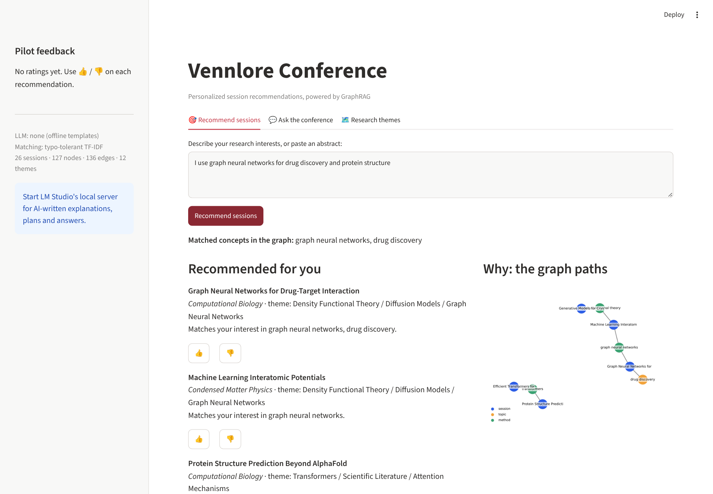
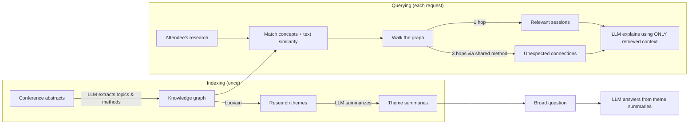

# Vennlore Conference

**GraphRAG-powered session recommendations for academic and professional conferences.**

An attendee describes their research in plain words. Vennlore walks a knowledge graph of the
conference program to recommend the most relevant sessions, surfaces *unexpected connections*
from other fields that share their methods, explains every pick with the graph path behind it,
and answers big-picture questions about the conference's research themes.

Runs entirely free: a local open-source LLM (LM Studio or Ollama), no paid API required.



---

## Features

| Tab | What it does | GraphRAG technique |
|---|---|---|
| 🎯 **Recommend sessions** | Ranked sessions, cross-disciplinary "unexpected connections", a personal conference plan | Local search: graph walk + LLM generation |
| 💬 **Ask the conference** | Answers broad questions such as *"Which themes combine AI and physics?"* | Global search over community summaries |
| 🗺️ **Research themes** | Automatically discovered themes spanning tracks | Louvain community detection + LLM summaries |
| 👍 / 👎 **Feedback** | Testers rate each recommendation; sidebar shows "% rated relevant" | Evaluation |

---

## How it works



1. **Extraction.** An LLM reads each abstract and extracts *topics* and *methods*, reusing existing
   names so that sessions share nodes.
2. **Graph.** Each session links to its topics, methods and track (NetworkX).
3. **Communities.** Louvain community detection groups concepts that sessions use together into
   themes, and an LLM writes a summary of each.
4. **Local search.** Score = text similarity + graph evidence. One hop from the attendee's concepts
   gives relevant sessions; three hops (session → shared method → session in another track) gives
   unexpected connections.
5. **Generation.** The LLM receives only the retrieved sessions and graph paths, so its explanations
   stay grounded in real data.

Retrieval decides *what* to recommend; the LLM only decides *how to explain it*. Without an LLM the
app still works, with template explanations.

---

## Project structure

```
vennlore-prototype/
├── app.py               Streamlit interface: three tabs, feedback, graph visual
├── graph_index.py       Indexing: graph, text index, communities, theme summaries
├── retrieval.py         Querying: local search, global search, grounded generation
├── llm.py               LLM wrapper: local (LM Studio / Ollama) or free cloud API, else offline
├── extract_topics.py    LLM entity extraction: raw abstracts -> sessions.csv
├── fetch_arxiv.py       Downloads real papers from arXiv as stand-in sessions
├── learn_rag.py         Plain RAG in ~40 lines, with exercises (learning aid)
├── sessions.csv         Sample sessions (replace with real data)
├── requirements.txt
├── pyproject.toml       Formatting and lint settings (black, ruff)
└── docs/screenshot.png
```

---

## Quick start

```bash
git clone https://github.com/<your-username>/vennlore-prototype.git
cd vennlore-prototype
python -m venv .venv
.venv\Scripts\activate          # Windows   (macOS/Linux: source .venv/bin/activate)
pip install -r requirements.txt
streamlit run app.py
```

Open http://localhost:8501. The app runs offline straight away; add an LLM for AI-written text.

### Free LLM options (pick one)

| Option | Cost | Setup |
|---|---|---|
| **LM Studio** (recommended) | Free, no key | Download a 7-8B *instruct* model (e.g. Qwen 2.5 7B Instruct), load it, open the **Developer** tab and **Start Server**. Detected automatically at `http://localhost:1234`. |
| **Ollama** | Free, no key | `ollama run <model>`, then set `LOCAL_LLM_URL=http://localhost:11434/v1` |
| **Groq / OpenRouter** | Free tier with rate limits | Set `LLM_API_URL`, `LLM_API_KEY`, `LLM_MODEL` |

Never commit API keys. Use environment variables, or Streamlit's **Secrets** when deploying.

### Use real data (arXiv)

```bash
python fetch_arxiv.py                       # ~30 recent papers across 6 fields -> raw_sessions.csv
python extract_topics.py raw_sessions.csv   # LLM builds topics/methods -> sessions.csv
streamlit run app.py                        # delete communities.json first if it exists
```

Each arXiv category acts as a track and each paper as a stand-in session. In production, conference
organizers would supply their own program.

### Optional: better matching

```bash
pip install sentence-transformers
```

The app switches from typo-tolerant TF-IDF to sentence embeddings automatically.

---

## Demo queries

- `I use graph neural networks for drug discovery and protein structure`
- `machine learning in quantum computing`
- `GPU kernels and distributed training`
- Ask tab: `What are the main research themes that combine AI with the physical sciences?`

---

## Limitations and roadmap

- Current data is **sample sessions**; next step is a real conference program.
- Extraction uses two entity types (topics, methods) with no separate entity-resolution step.
- Feedback is stored locally in `feedback.csv`.
- **Next:** sentence embeddings by default, Personalized PageRank graph search, an organizer
  analytics dashboard, B2C trend tracking and a recruiter view.

---

## Team

Vijyaksha Yentrapragada · Jiahong Wen · Owen Gill · Rupert Lim · Ryu Takamatsu

Built for ESE 6800 ventures at the University of Pennsylvania, with AI-assisted help development.
